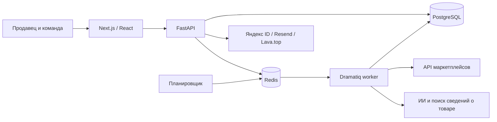

# MPReply

<div align="center">
  
  <h2>Отзывы, вопросы и сообщения покупателей — в одном рабочем кабинете</h2>
  <p>Контекст товара, ИИ-черновики, правила автоответов и история отправки.</p>
  <p><a href="https://mpreply.ru">Сайт</a> · <a href="https://app.mpreply.ru">Кабинет</a> · <a href="https://mpreply.ru/demo">Демо</a> · <a href="https://github.com/fedorovich-web/mpreply/actions/workflows/quality-gate.yml">Проверки</a></p>
</div>

MPReply собирает поддерживаемые обращения с маркетплейсов, помогает продавцам и командам подготовить ответ с учётом товара и отправить его автоматически либо после проверки человеком. Каждая организация имеет отдельные кабинеты, участников, правила и историю работы.

## Как устроена работа

1. Продавец подключает кабинет маркетплейса. Сервер проверяет доступ и шифрует ключ.
2. Фоновые задачи загружают обращения и контекст товара в общую очередь.
3. ИИ готовит черновик. Для вопросов о товаре поиск добавляет найденные сведения и источники; неподтверждённая совместимость требует проверки.
4. Правила организации и проверки безопасности определяют дальнейшее действие.
5. Рабочая задача отправляет разрешённый ответ и сохраняет результат, задержки и ошибки.

| Режим | Что происходит |
| --- | --- |
| `semi_auto` | ИИ или сотрудник готовит черновик; пользователь проверяет и подтверждает отправку. |
| `auto` | Допустимые по правилам ответы отправляются без обязательного подтверждения человеком. Неопределённые и рискованные случаи переходят на проверку. |

Автоматический режим сохраняет проверки доступа, квоты, состояния обращения и повторной отправки. Неоднозначный результат запроса не считается подтверждённой публикацией.

Квота резервируется в транзакции с блокировкой строки организации. Незавершённая отправка и случай, требующий проверки после неоднозначного ответа провайдера, продолжают занимать место в часовом и суточном лимитах. Это защищает от превышения лимита при параллельной обработке и перезапуске задачи. Начисление и расход AI-баланса имеют отдельный журнал с защитой от повторного списания.

Провайдер генерации выбирается на сервере через `AI_REPLY_PROVIDER`. По умолчанию используется Groq и модель из `GROQ_DEFAULT_MODEL`. Режим `openrouter` требует отдельного `OPENROUTER_API_KEY` и распределяет обращения между четырьмя моделями:

| Обращение | Модель в режиме OpenRouter |
| --- | --- |
| Обычный отзыв | DeepSeek V4.1 Flash (`deepseek/deepseek-v4.1-flash`) |
| Отзыв с оценкой 1–2 | Claude Sonnet 5.5 (`anthropic/claude-sonnet-5.5`) |
| Вопрос о товаре | GPT-6 Luna (`openai/gpt-6-luna`) |
| Сообщение покупателя | Gemini 3.8 Flash (`google/gemini-3.8-flash`) |

Поиск сведений о товаре продолжает работать через Groq в обоих режимах. Фактические провайдер, модель, расход токенов и результаты проверок сохраняются вместе с черновиком. OpenRouter не повторяет неоднозначные запросы и не переключается на другую модель при ошибке. Наличие адаптера в коде не подтверждает доступность моделей для конкретного ключа; порядок активации и ограниченной проверки описан в [инструкции](docs/ops/llm-routing.md).

## Интеграции

| Маркетплейс | Поддерживаемые обращения |
| --- | --- |
| Wildberries | Отзывы и вопросы покупателей |
| Ozon | Отзывы и вопросы покупателей |
| Яндекс Маркет (Yandex Market) | Отзывы о товарах и вопросы покупателей |
| Авито (Avito) | Чаты и поддерживаемые отзывы |

Все четыре интеграции представлены в интерфейсе. Доступ конкретного кабинета зависит от прав его ключа и доступности API маркетплейса. Наличие адаптера и успешные локальные тесты не заменяют проверку реального кабинета.

WB ограничивает запросы на стороне продавца и категории API. MPReply учитывает общий бюджет отзывов и вопросов для чтения и отправки; проверка `/ping` имеет отдельный бюджет. Базовый ключ предусмотрен для подключений вне Каталога решений. По текущей документации его бюджет категории — 5 запросов в час, интервал 12 минут и всплеск 1; `X-Ratelimit-Limit` обозначает всплеск, а не всю часовую квоту. Опциональный `WB_SERVICE_SECRET` передаёт выданный WB секрет авторизованного сервиса; отсутствие такого секрета само по себе не означает недействительный базовый ключ. [Документация методов и лимитов WB](https://dev.wildberries.ru/docs/openapi/customer-communication), [авторизация и типы доступа](https://dev.wildberries.ru/docs/openapi/api-information).

Установка, которая используется только с собственным кабинетом продавца, может работать с персональным ключом WB. Для неё задаются `WB_INTEGRATION_MODE=self_hosted` и `WB_SELF_HOSTED_SELLER_HASH` — SHA256 строки `seller:<канонический UUID sid из ключа>`. Сохраняется привязка к продавцу при смене ключа: ключ другого продавца, тестовый или сервисный ключ блокируется до HTTP-запроса. `WB_SERVICE_SECRET` в этом режиме должен быть пустым. По умолчанию действует режим `cloud`, который запрещает персональные и тестовые ключи; включение собственного режима не отключает производственный Redis-лимитер, проверку существующего ответа и защиту исполнения. Персональный ключ категории отзывов и вопросов имеет лимит 3 запроса в секунду, всплеск 6. Режим не предназначен для подключения сторонних продавцов. [Разъяснение WB для собственного решения](https://dev.wildberries.ru/forum/topics/2069/limity-na-api).

## Архитектура



| Часть | Технологии и назначение |
| --- | --- |
| `apps/api` | Python 3.13+, FastAPI, SQLAlchemy, Alembic, Pydantic; авторизация, RBAC, адаптеры и фоновые задачи |
| `apps/web` | Node.js 22.19+, Next.js, React, TypeScript; публичный сайт и рабочий кабинет |
| PostgreSQL | Данные организаций, кабинетов, обращений, ответов и оплат |
| Redis | Очередь задач, координация запросов и ограничения частоты |
| `infra/docker` | Compose для локального и производственного окружений |
| `infra/dokploy` | Инструкции развёртывания и проверки |
| `scripts` | Проверки выпуска и контейнеров |
| `docs` | Продуктовые решения, архитектура, QA и эксплуатация |

В Compose зафиксированы PostgreSQL 18.1 и Redis 8.4. Точные версии библиотек находятся в `apps/api/pyproject.toml` и `apps/web/package-lock.json`.

## Локальный запуск

Нужны Python 3.13 или 3.14, Node.js 22.19+ и доступные PostgreSQL/Redis. Команды ниже приведены для PowerShell. При обычном запуске вне контейнеров API читает `apps/api/.env`; переменные Compose берутся из корневого `.env`.

```powershell
git clone https://github.com/fedorovich-web/mpreply.git
cd mpreply
python -m venv .venv
.\.venv\Scripts\python.exe -m pip install -e ".\apps\api[dev]"
Copy-Item .env.example apps/api/.env
```

В новом `apps/api/.env` укажите адреса локальных PostgreSQL/Redis и собственные `AUTH_SECRET_KEY` и `CREDENTIALS_ENCRYPTION_KEY`. Не используйте значения-заглушки в production. Для нового локального окружения значения можно получить так:

```powershell
.\.venv\Scripts\python.exe -c "import secrets; print(secrets.token_hex(32))"
.\.venv\Scripts\python.exe -c "from cryptography.fernet import Fernet; print(Fernet.generate_key().decode())"
```

Миграции и API:

```powershell
cd apps/api
..\..\.venv\Scripts\alembic.exe upgrade head
..\..\.venv\Scripts\python.exe -m uvicorn app.main:app --reload --host 127.0.0.1 --port 8000
```

Для фоновой обработки в отдельном тестовом окружении из `apps/api` запускаются обработчик очереди и планировщик. Они выполняют задачи подключённых аккаунтов; используйте тестовые данные и разрешённые для них интеграции. Для просмотра интерфейса эти процессы не нужны.

```powershell
..\..\.venv\Scripts\python.exe -m dramatiq app.workers.auto_reply app.workers.marketplace_sync app.workers.automatic_drafts --processes 1 --threads 4
```

```powershell
..\..\.venv\Scripts\python.exe -m app.workers.marketplace_scheduler
```

Для web создайте `apps/web/.env.local`:

```dotenv
NEXT_PUBLIC_API_BASE_URL=http://localhost:8000
NEXT_PUBLIC_SITE_URL=http://localhost:3000
NEXT_PUBLIC_CONTACT_EMAIL=support@mpreply.ru
```

```powershell
cd apps/web
npm ci
npm run dev
```

Web: `http://localhost:3000`. API: `http://localhost:8000`. Реальная отправка писем, ответы ИИ и обращение к внешним сервисам требуют соответствующих ключей.

Если Docker разрешён в вашем окружении, весь локальный стек можно запустить из корня после подготовки корневого `.env`:

```powershell
docker compose -f infra/docker/docker-compose.local.yml up --build -d --wait
```

Обычный `docker compose ... down` сохраняет именованные тома. Удаление томов означает удаление локальных данных.

## Настройки и секреты

| Назначение | Основные переменные backend |
| --- | --- |
| База и очередь | `DATABASE_URL`, `REDIS_URL` |
| Авторизация и шифрование | `AUTH_SECRET_KEY`, `CREDENTIALS_ENCRYPTION_KEY` |
| ИИ | `GROQ_API_KEY`, `GROQ_DEFAULT_MODEL` |
| Письма | `RESEND_API_KEY`, `TRANSACTIONAL_EMAIL_FROM` |
| Wildberries | Ключ продавца хранится в зашифрованном виде в базе. Опциональный `WB_SERVICE_SECRET` — выданный WB секрет авторизованного сервиса; для обычного базового подключения вне Каталога не требуется |
| Яндекс ID | `YANDEX_OAUTH_ENABLED`, `YANDEX_OAUTH_CLIENT_ID`, `YANDEX_OAUTH_CLIENT_SECRET` |
| Lava.top | `LAVA_ENABLED`, `LAVA_API_KEY`, `LAVA_PRODUCT_ID`, `LAVA_OFFER_ID`, `LAVA_WEBHOOK_SECRET` |
| Производственное окружение | `CORS_ALLOWED_ORIGINS`, `ALLOWED_HOSTS`, `FORWARDED_ALLOW_IPS`, `DEPLOYMENT_VERSION` |

Полный шаблон: [`.env.example`](.env.example). Переменные `NEXT_PUBLIC_*` доступны браузеру и содержат только публичные настройки. Секреты провайдеров и маркетплейсов остаются на backend; реальные `.env` не коммитятся.

**Яндекс ID.** Вход и создание аккаунта используют callback `https://api.mpreply.ru/api/auth/yandex/callback`. Связывание существующей учётной записи требует подтверждения владения аккаунтом MPReply; одного совпадения email недостаточно.

**Lava.top.** Оплата тарифов и дополнительных пакетов — разовая, без автосписаний. Webhook: `https://api.mpreply.ru/api/billing/lava/webhook`. Начисление выполняется после проверки уведомления и счёта, с защитой от повторного события. Настройка ключей не является доказательством успешной реальной оплаты.

Пошаговая настройка: [Lava.top и Яндекс ID](docs/ops/lava-yandex-setup.md).

## Проверки качества

Из корня, после установки API в корневую `.venv` и зависимостей web:

```powershell
.\scripts\release-gate.ps1
```

Полный набор frontend-проверок из `apps/web`:

Для локальной проверки в Brave задайте путь к установленному браузеру; используются отдельные тестовые профили:

```powershell
$env:PLAYWRIGHT_CHROMIUM_EXECUTABLE_PATH = "C:\Program Files\BraveSoftware\Brave-Browser\Application\brave.exe"
$env:CHROME_PATH = $env:PLAYWRIGHT_CHROMIUM_EXECUTABLE_PATH
```

```powershell
npm run test:unit
npm run test:design-tokens
npm run typecheck
npm run lint
npm run test:unused
npm run validate:css-syntax
npm run build
npm run validate:w3c
npm run test:e2e
npm run test:a11y
npm run test:visual
npm run lighthouse
```

В окружении с Docker дополнительно запускается `scripts/container-gate.ps1`. Визуальные эталоны обновляются после проверки и одобрения результата, а не для подавления ошибки CI. Актуальные результаты находятся в [GitHub Actions](https://github.com/fedorovich-web/mpreply/actions/workflows/quality-gate.yml); README не фиксирует вечный статус «всё зелёное».

## Ветки и развёртывание

`main` — основная ветка репозитория и целевой источник производственных выпусков. Рабочие изменения проходят через pull request и обязательные проверки. Незавершённые ветки с уникальными коммитами сохраняются до переноса или отдельного решения об архивировании.

Production использует `infra/docker/docker-compose.production.yml`: миграции, API, web, worker и scheduler. PostgreSQL и Redis подключаются по приватной сети. Перед запуском проверьте эффективный Compose в Dokploy: патч полного файла может перекрывать настройки репозитория и исключать новые переменные.

**Операционная пауза.** Остановка worker и scheduler приостанавливает обработку очереди. Ручная отправка может быть поставлена в очередь, но будет ждать worker; синхронная AI-генерация через API остаётся доступной. Обычный запуск всего Compose может снова поднять остановленные процессы. Если владелец установил паузу, её сохранение проверяется до обновления `main` и до развёртывания; возобновление требует отдельного решения владельца.

`DEPLOYMENT_VERSION` — метка выпуска, заданная в конфигурации. Совпадение с Git подтверждается журналом сборки и сверкой файлов внутри контейнера. Для проверки состояния доступны:

- API `/health/live` — работоспособность процесса;
- API `/health/ready` — готовность API, PostgreSQL и Redis;
- web `/api/health` — состояние web.

Готовность контейнеров, проверки кода и фактическая работа внешнего провайдера проверяются отдельно. Зелёный health не подтверждает отправку ответа на маркетплейс или успешную оплату.

## Документация

- [Продукт и поддерживаемые сценарии](PRODUCT.md)
- [Дизайн и визуальные правила](DESIGN.md)
- [Инструкции для участников и агентов](AGENTS.md)
- [Архитектурные решения](docs/adr/)
- [QA и свидетельства проверок](docs/qa/)
- [Инженерная проверка и исправления от 24 октября 2026](docs/qa/2026-10-24-senior-cleanup.md)
- [Эксплуатация, резервные копии и восстановление](docs/ops/)
- [Чеклист развёртывания Dokploy](infra/dokploy/deployment-checklist.md)

Перед изменениями изучите продуктовый контекст и соответствующие инструкции. Изменения не должны ослаблять изоляцию организаций, RBAC, шифрование ключей, контроль повторной отправки и проверку неоднозначных результатов внешнего API.
